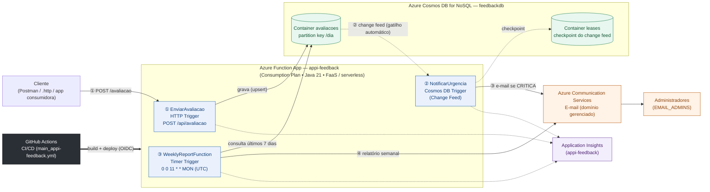

# feedback-platform

Aplicação Java 21 com três Azure Functions para registrar avaliações, notificar os
administradores sobre feedbacks críticos e enviar um relatório semanal.

```text
POST /api/avaliacao → Cosmos DB → Change feed → Alerta por e-mail
                          ↑
                  Timer semanal → Relatório por e-mail
```

Notas até 4 são classificadas como `CRITICA`; acima de 4, como `MEDIA`.

- [Como rodar localmente](#como-rodar-localmente)
- [Arquitetura e recriação do ambiente](#arquitetura-e-recriação-do-ambiente)
- [Funções](#funções)
- [Contrato da API](#contrato-da-api)
- [Variáveis de ambiente](#variáveis-de-ambiente)
- [Cosmos DB e permissões](#persistência-e-configuração-do-cosmos-db)
- [Testes e Javadoc](#testes-e-javadoc)
- [Problemas comuns](#problemas-comuns)

## Arquitetura e recriação do ambiente


- [Documento de arquitetura](docs/architecture.md): descreve os componentes, fluxos,
  decisões e limitações da solução. O diagrama-fonte editável está em
  [`docs/architecture.mmd`](docs/architecture.mmd).
- [Guia de recriação do ambiente Azure via Azure CLI](docs/guia-recriacao-ambiente-azure-cli.md):
  orienta o provisionamento manual dos recursos Azure.

## Como rodar localmente

### Pré-requisitos

- JDK 21 e Maven; confirme as versões com `java -version` e `mvn -version`.
- Azure CLI autenticada e acesso de dados ao banco e container Cosmos DB existentes.
- Azure Functions Core Tools 4.x (`func --version`).

No macOS, instale o Core Tools com Homebrew:

```bash
brew tap azure/functions
brew install azure-functions-core-tools@4
```

### Configurar apenas a API

Na raiz do repositório, execute `az login` e crie `local.settings.json`:

```json
{
  "IsEncrypted": false,
  "Values": {
    "FUNCTIONS_WORKER_RUNTIME": "java",
    "AzureWebJobsStorage": "",
    "COSMOS_ENDPOINT": "https://<conta>.documents.azure.com:443/",
    "COSMOS_DATABASE": "<banco>",
    "COSMOS_CONTAINER_AVALIACOES": "<container>",
    "AzureWebJobs.NotificarUrgencia.Disabled": "true",
    "AzureWebJobs.WeeklyReportFunction.Disabled": "true"
  }
}
```

Substitua os valores do Cosmos DB. O arquivo está no `.gitignore` e não deve ser
versionado. Essa configuração desabilita as duas funções de background; a API roda
localmente e grava no banco informado. O Cosmos DB não é emulado por essa configuração.
As permissões necessárias estão na [seção de Cosmos DB](#persistência-e-configuração-do-cosmos-db).

### Compilar e iniciar

```bash
mvn clean package
mvn azure-functions:run
```

O host deve exibir `http://localhost:7071/api/avaliacao`. Em outro terminal, execute o
[curl de teste](#testar-localmente). Para encerrar o host, pressione `Ctrl+C`.

### Executar também as funções de background

No `local.settings.json`, remova as duas entradas `AzureWebJobs.<funcao>.Disabled`
ou altere seus valores para `"false"`. Configure as variáveis de change feed e e-mail
listadas em [Variáveis de ambiente](#variáveis-de-ambiente).

Para o armazenamento do host, configure `AzureWebJobsStorage` com uma conexão de
desenvolvimento ou use `UseDevelopmentStorage=true` com Azurite em execução.
O container de leases deve existir e a identidade do binding precisa ter acesso a ele.
Com essas funções habilitadas, o processamento pode enviar e-mails reais.

## Funções

| Função no Azure | Trigger | Responsabilidade |
| --- | --- | --- |
| `EnviarAvaliacao` | HTTP POST | Receber o feedback e delegar validação e registro |
| `NotificarUrgencia` | Change feed do Cosmos DB | Acionar alertas para avaliações críticas |
| `WeeklyReportFunction` | Timer semanal | Coordenar geração e envio do relatório |

### EnviarAvaliacao

- **Trigger:** `POST /api/avaliacao`, autorização `FUNCTION`.
- **Entrada:** JSON com `descricao` e `nota`.
- **Saída:** avaliação persistida e resposta JSON com status `201`, `400` ou `500`.
- **Ambiente:** `COSMOS_ENDPOINT`, `COSMOS_DATABASE` e `COSMOS_CONTAINER_AVALIACOES`.

A validação e a persistência são delegadas a `AvaliacaoService`. O envio de alertas é
acionado pelo change feed e não faz parte da requisição HTTP. Veja o [contrato da API](#contrato-da-api).

### NotificarUrgencia

- **Trigger:** change feed do container de avaliações.
- **Entrada:** lote JSON de documentos criados ou atualizados.
- **Saída:** um e-mail por avaliação crítica para todos os administradores e logs de processamento.
- **Ambiente:** `COSMOS_DATABASE`, `COSMOS_CONTAINER_AVALIACOES`, `COSMOS_LEASES_CONTAINER`,
  prefixo `COSMOS_CONNECTION`, `ACS_CONNECTION_STRING`, `EMAIL_REMETENTE` e `EMAIL_ADMINS`.

Exemplo de lote entregue pelo binding (propriedades extras do Cosmos são ignoradas):

```json
[
  {
    "id": "48ee355b-2c12-4dd9-96b8-57fcb54b7e5c",
    "descricao": "Não consegui acompanhar a aula",
    "nota": 3,
    "dia": "2026-11-10",
    "dataEnvio": "2026-11-10T10:30:00-03:00"
  }
]
```

Esse lote produz um e-mail com assunto `[URGENTE] Avaliação crítica recebida` e corpo:

```text
Uma avaliação crítica foi registrada na plataforma de feedback.

Descrição: Não consegui acompanhar a aula
Urgência: CRITICA
Data de envio: 10/11/2026 10:30
```

Notas acima de 4 e itens nulos são ignorados. A função não retorna JSON nem resposta HTTP.
Falhas de leitura ou envio são propagadas; o código declara `@FixedDelayRetry` com três
repetições e intervalo de dez segundos. O processamento não implementa deduplicação:
reprocessar um lote ou atualizar uma avaliação crítica pode repetir o alerta. Uma falha
interrompe o restante do lote, mesmo que alguns e-mails já tenham sido enviados.

### WeeklyReportFunction

- **Trigger:** timer com NCRONTAB `0 0 11 * * MON`.
- **Entrada:** metadados do timer e avaliações consultadas no Cosmos DB.
- **Saída:** e-mail com total, média, quantidades por dia e urgência e lista de avaliações.
- **Ambiente:** `COSMOS_ENDPOINT`, `COSMOS_DATABASE`, `COSMOS_CONTAINER_AVALIACOES`,
  `ACS_CONNECTION_STRING`, `EMAIL_REMETENTE` e `EMAIL_ADMINS`; armazenamento do host para o timer.

O cron usa seis campos: segundo, minuto, hora, dia, mês e dia da semana. Foi definido
para o host em UTC: segunda-feira às 11h UTC corresponde a 08h em Brasília (UTC-3).
Uma configuração de fuso do host pode mudar essa interpretação.

O argumento `timerInfo` é fornecido pelo host e não é lido pelo código. O relatório considera
o dia atual e os seis anteriores em `America/Sao_Paulo`, com limites inclusivos, percorrendo
todas as páginas. Notas até 4 são `CRITICA`; as demais são `MEDIA`. Não há endpoint HTTP
para gerar o relatório.

Exemplo de saída para uma avaliação com nota 3 em um disparo em 16/11/2026:

```text
Assunto: Relatório semanal de avaliações (10/11/2026 a 16/11/2026)

Relatório semanal de avaliações
Período: 10/11/2026 a 16/11/2026

Total de avaliações: 1
Média das notas: 3,00

Quantidade por dia:
  10/11/2026: 1

Quantidade por urgência:
  CRITICA: 1
  MEDIA: 0

Avaliações:
  - [CRITICA] Não consegui acompanhar a aula (enviada em 2026-11-10T10:30:00-03:00)
```

Sem avaliações, o e-mail ainda é enviado com total zero e indicação de ausência de dados.
Falhas de consulta ou envio são registradas e propagadas ao runtime; não há política de
retry explícita nessa função.

Para disparar manualmente no Azure Portal, abra `WeeklyReportFunction` em **Code + Test**
e use **Test/Run**. Isso consulta o Cosmos DB e envia um e-mail real aos administradores.

## Contrato da API

### Registrar avaliação

- **Método e rota:** `POST /api/avaliacao`.
- **Autorização:** nível `FUNCTION`; no Azure, enviar a chave da função no header
  `x-functions-key` ou no parâmetro `code`. A autenticação é tratada pelo host.
- **Conteúdo:** request e response em JSON; as respostas do handler usam
  `Content-Type: application/json`.

| Campo de entrada | Tipo esperado | Regra |
| --- | --- | --- |
| `descricao` | string | Obrigatória e não vazia; aplica `trim` e aceita até 1.000 caracteres após normalização |
| `nota` | inteiro | Obrigatória, de 0 a 10, inclusive |

O corpo é desserializado pelo Jackson com as configurações padrão do `ObjectMapper`.
Campos desconhecidos causam `400`; não há configuração adicional para rejeitar todas as
coerções de tipos do Jackson. `id`, `dia` e `dataEnvio` são gerados pelo serviço e não devem
ser enviados. A API não envia e-mails diretamente.

### Testar localmente

Com o host em execução, não é necessária chave por padrão:

```bash
curl -i -X POST 'http://localhost:7071/api/avaliacao' \
  -H 'Content-Type: application/json' \
  -d '{"descricao":"Aula muito boa","nota":9}'
```

### Testar no Azure

No Portal, abra **Function App → Functions → EnviarAvaliacao → Function Keys** e copie
a chave `default`. A opção **Get function URL** também fornece a URL com `code`.
Use o domínio exibido no Portal:

```bash
curl -i -X POST 'https://<dominio-da-function-app>/api/avaliacao' \
  -H 'Content-Type: application/json' \
  -H 'x-functions-key: <chave-da-funcao>' \
  -d '{"descricao":"Aula muito boa","nota":9}'
```

O prefixo `/api` é adicionado pelo host; `route = "avaliacao"` define o restante.
Ele pode ser alterado por `extensions.http.routePrefix` no `host.json`.

### Respostas

Response **201 Created** (identificador e datas ilustrativos):

```json
{
  "id": "48ee355b-2c12-4dd9-96b8-57fcb54b7e5c",
  "descricao": "Aula muito boa",
  "nota": 9,
  "dia": "2026-11-10",
  "dataEnvio": "2026-11-10T10:30:00-03:00"
}
```

`dia` usa `yyyy-MM-dd`; `dataEnvio` é uma data/hora ISO-8601 com offset. Ambos são gerados
no fuso `America/Sao_Paulo`. A urgência é calculada pelo domínio, não é um campo do record
retornado.

| Status do handler | Situação |
| --- | --- |
| `201 Created` | Avaliação persistida |
| `400 Bad Request` | Corpo ausente/vazio, erro de desserialização ou falha de validação |
| `500 Internal Server Error` | Outras exceções durante o registro |

Os erros usam o formato JSON:

```json
{"erro":"nota deve estar entre 0 e 10"}
```

| Exemplo de entrada inválida | Mensagem (`400`) |
| --- | --- |
| Corpo ausente ou vazio | `corpo da requisicao e obrigatorio` |
| `{"descricao":"Aula","nota":11}` | `nota deve estar entre 0 e 10` |
| `{"descricao":"   ","nota":5}` | `descricao e obrigatoria` |
| `{"descricao":"Aula"}` | `nota e obrigatoria` |

Erros de parsing usam a mensagem do Jackson, cujo texto depende da falha; o formato
permanece `{"erro":"..."}`. Outras falhas capturadas pelo handler retornam **500**:

```json
{"erro":"erro interno ao registrar avaliacao"}
```

Limitações atuais: o corpo JSON literal `null` também resulta em `500`; falhas na
inicialização da função e respostas de autenticação do host não passam pelo tratamento
JSON do handler.

## Variáveis de ambiente

As variáveis abaixo não têm padrão, salvo indicação explícita. Use valores reais apenas no
ambiente ou nas configurações locais não versionadas.

| Variável/configuração | Obrigatória para | Uso / padrão |
| --- | --- | --- |
| `COSMOS_ENDPOINT` | `EnviarAvaliacao`, `WeeklyReportFunction` | Endpoint da conta usada pelo SDK Java |
| `COSMOS_DATABASE` | As três funções | Nome do banco |
| `COSMOS_CONTAINER_AVALIACOES` | As três funções | Container de avaliações |
| `COSMOS_LEASES_CONTAINER` | `NotificarUrgencia` | Container de leases do change feed; deve existir, pois o código não habilita sua criação automática |
| `COSMOS_CONNECTION` (prefixo de conexão do binding) | `NotificarUrgencia` | Configure a conexão do runtime separadamente do SDK; para identidade, use `COSMOS_CONNECTION__accountEndpoint` com o endpoint da conta e conceda acesso aos containers de avaliações e leases |
| `ACS_CONNECTION_STRING` | `NotificarUrgencia`, `WeeklyReportFunction` | Conexão do Azure Communication Services Email |
| `EMAIL_REMETENTE` | `NotificarUrgencia`, `WeeklyReportFunction` | Remetente autorizado no ACS |
| `EMAIL_ADMINS` | `NotificarUrgencia`, `WeeklyReportFunction` | Um ou mais destinatários separados por vírgula; espaços e entradas vazias são descartados |
| `FUNCTIONS_WORKER_RUNTIME` | Host local | Definir como `java` |
| `AzureWebJobsStorage` | Host com funções de background | Conexão de armazenamento; `UseDevelopmentStorage=true` exige Azurite em execução |
| `COSMOS_AVALIACOES_PAGE_SIZE` | Opcional, repositório | Padrão `100`, intervalo de `1` a `1000`; afeta apenas `buscarDesde(dia)`. O relatório usa explicitamente páginas de `100` |

O SDK usa `DefaultAzureCredential`. O binding `COSMOS_CONNECTION` é resolvido pelo host,
não por `CosmosClientProvider`. Configurar apenas `COSMOS_ENDPOINT` não configura o trigger.
O projeto usa Java 21 e o extension bundle 4.x de `host.json`.

### Configuração de e-mail

O `EmailService` envia alertas e relatórios para todos os endereços configurados em
`EMAIL_ADMINS`, sem consultar banco de dados. O envio aguarda a conclusão no Azure
Communication Services; falhas de configuração ou do Azure são propagadas ao chamador.

Configure as variáveis de ambiente abaixo:

```text
ACS_CONNECTION_STRING=endpoint=...;accesskey=...
EMAIL_REMETENTE=DoNotReply@seu-dominio.azurecomm.net
EMAIL_ADMINS=admin1@example.com,admin2@example.com
```

`EMAIL_ADMINS` deve conter pelo menos um endereço, separado por vírgulas. Não
versione valores reais dessas variáveis.

## Persistência e configuração do Cosmos DB

`AvaliacaoRepository` persiste o record `Avaliacao`; `CosmosClientProvider` compartilha
um único cliente por processo. O SDK usa `DefaultAzureCredential`: Azure CLI no
ambiente local e Managed Identity no Azure, sem chaves de conta.

`dia` é a data de avaliação e deve ser persistida como `yyyy-MM-dd`. A consulta
`buscarDesde(LocalDate)` usa `c.dia >= @dia` parametrizado e devolve uma página; o
token de continuação em `PaginaAvaliacao` deve ser usado com a sobrecarga para ler a
próxima página. Como a comparação é textual, o formato ISO é obrigatório. A gravação
usa `upsertItem` e deixa o SDK extrair a chave de partição do documento conforme a
política já existente no container; portanto, o container precisa ter uma chave de
partição que corresponda a uma propriedade presente no documento.

### Configuração e permissões

Após `az login`, carregue a configuração no shell atual:

```bash
source scripts/azure/cosmos-local-setup.sh --endpoint "https://<conta>.documents.azure.com:443/" --database "<banco>" --container "<container>" --subscription "<assinatura>"
```

Conceda a função de dados de menor privilégio necessária (`Cosmos DB Built-in Data
Contributor`) no escopo do banco. A operação requer uma identidade que possa criar
atribuições de dados do Cosmos DB; isso pode depender de um administrador da assinatura.

```bash
# Desenvolvedor autenticado pelo Azure CLI
scripts/azure/cosmos-assign-data-role.sh --resource-group "<rg>" --account "<conta>" --database "<banco>"

# Managed Identity de uma Function App
scripts/azure/cosmos-assign-data-role.sh --resource-group "<rg>" --account "<conta>" --database "<banco>" --function-app "<function-app>"
```

Os scripts consultam a definição da função, fazem a atribuição no escopo
`.../dbs/<banco>` e listam a atribuição criada. Eles não provisionam ou substituem
recursos. Confirme antes que conta, banco e container já existentes são os corretos.

## Testes e Javadoc

Use Maven com JDK 21:

```bash
# Testes locais e empacotamento das três funções, sem integrações reais
EMAIL_INTEGRATION_TEST=false COSMOS_INTEGRATION_TEST=false mvn clean package

# Javadoc: validar referências, sintaxe e documentação pública
mvn org.apache.maven.plugins:maven-javadoc-plugin:3.11.2:javadoc -Ddoclint=all -DfailOnWarnings=true
```

Os testes de integração são opt-in: habilite-os somente para validar os serviços reais.

### Integração com Cosmos DB

O teste de integração é intencionalmente desabilitado por padrão e não remove dados.
Ele cria uma avaliação com id `integration-<UUID>`, busca desde a data atual e percorre
as páginas até encontrá-la.

```bash
COSMOS_INTEGRATION_TEST=true mvn -Dtest=AvaliacaoRepositoryIntegrationTest test
```

Para validar manualmente, abra no Azure Portal a conta indicada em `COSMOS_ENDPOINT`,
selecione `COSMOS_DATABASE`, depois `COSMOS_CONTAINER_AVALIACOES`, abra **Data
Explorer** e pesquise pelo id `integration-...` emitido pelo teste. Confirme `id` e
`dia`. A validação só está concluída depois de uma execução bem-sucedida contra a conta
real.

### Integração com e-mail

Com as variáveis de e-mail configuradas, o comando abaixo envia uma mensagem real:

```bash
EMAIL_INTEGRATION_TEST=true mvn -Dtest=EmailServiceIntegrationTest test
```

## Problemas comuns

| Sintoma | O que verificar |
| --- | --- |
| `func: command not found` | Instale Core Tools 4.x e abra um terminal com o executável no `PATH` |
| `invalid target release: 21` | Execute `mvn -version` e ajuste `JAVA_HOME` para JDK 21 |
| Falha de credencial no Cosmos DB | Execute `az login`; confira a conta usada pelo `DefaultAzureCredential` |
| `403` do Cosmos DB | Confira as permissões de dados no banco e containers; acesso à assinatura não implica acesso aos dados |
| Falha de conexão ao armazenamento local | Com `UseDevelopmentStorage=true`, mantenha Azurite em execução |
| Falha ao iniciar o change feed | Confira `COSMOS_CONNECTION`, banco, container de avaliações e leases; a conexão do SDK não configura o binding |
| `401` ao chamar a API no Azure | Envie uma chave válida em `x-functions-key` ou `code`; confira também autenticação adicional da Function App |
| `404` ao chamar a API | Use `POST /api/avaliacao` e confira o prefixo HTTP em `host.json` |
| `500` no registro | Consulte os logs; confira configuração, credenciais e acesso ao Cosmos DB |
| Porta `7071` ocupada | Encerre outro host local que esteja usando a porta |

Referências: [execução local](https://learn.microsoft.com/en-us/azure/azure-functions/functions-run-local),
[configuração local](https://learn.microsoft.com/en-us/azure/azure-functions/functions-develop-local),
[chaves de acesso](https://learn.microsoft.com/en-us/azure/azure-functions/function-keys-how-to)
e [rotas HTTP](https://learn.microsoft.com/en-us/azure/azure-functions/functions-bindings-http-webhook-trigger).
