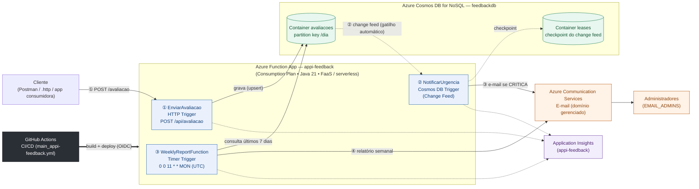

# Arquitetura — feedback-platform

[⬅ Voltar ao README](../README.md)

Este documento descreve a arquitetura efetivamente implementada no repositório
`feedback-platform`: três Azure Functions em Java 21, Azure Cosmos DB for NoSQL como
persistência e gatilho de eventos, Azure Communication Services para envio de e-mail,
Application Insights para observabilidade e GitHub Actions para CI/CD. O conteúdo
reflete o código em `src/main/java/com/techchallenge/feedback`, o `pom.xml`, o
`host.json` e o workflow `.github/workflows/main_appi-feedback.yml` no momento desta
análise — não descreve funcionalidades planejadas como se já existissem; itens ainda
não implementados estão listados na seção 7.

## Sumário

1. [Visão geral da arquitetura](#1-visão-geral-da-arquitetura)
2. [Modelo de cloud escolhido](#2-modelo-de-cloud-escolhido)
3. [Organização das Azure Functions](#3-organização-das-azure-functions)
4. [Decisão arquitetural: não utilizar Spring Boot nas Functions](#4-decisão-arquitetural-não-utilizar-spring-boot-nas-functions)
5. [Processamento de alertas com Cosmos DB Change Feed](#5-processamento-de-alertas-com-cosmos-db-change-feed)
6. [Monitoramento e CI/CD](#6-monitoramento-e-cicd)
7. [Limitações conhecidas e evolução futura](#7-limitações-conhecidas-e-evolução-futura)

---

## 1. Visão geral da arquitetura

A solução é composta por uma única **Azure Function App** (`appi-feedback`), em plano de
**Consumo (Consumption Plan)**, hospedando três funções independentes, um banco
**Azure Cosmos DB for NoSQL** (`feedbackdb`) e um serviço de e-mail gerenciado
(**Azure Communication Services**). Não há fila de mensageria própria no projeto: o
disparo do alerta de urgência nasce do **Change Feed** do Cosmos DB, não de uma
fila intermediária.

Fluxo de ponta a ponta:

1. Um cliente HTTP envia `POST /api/avaliacao` para a função **EnviarAvaliacao**, que
   valida e grava o documento no container `avaliacoes`.
2. A gravação é detectada pelo **Change Feed** do container `avaliacoes`, que aciona
   automaticamente a função **NotificarUrgencia**. Essa função filtra avaliações
   classificadas como `CRITICA` (nota ≤ 4) e envia um e-mail de alerta via Azure
   Communication Services.
3. Semanalmente, um **Timer Trigger** aciona a função **WeeklyReportFunction**, que
   consulta os últimos 7 dias no mesmo container, consolida métricas e envia um
   relatório por e-mail aos administradores.
4. As três funções enviam logs, métricas e falhas ao **Application Insights**.
5. O **GitHub Actions** testa, empacota e publica o código na Function App a cada
   push na branch `main` (ou manualmente, via `workflow_dispatch`).

### Diagrama oficial

O arquivo-fonte editável do diagrama é [`architecture.mmd`](architecture.mmd)
(Mermaid). Ele também é reproduzido abaixo, renderizando nativamente em visualizadores
com suporte a Mermaid (GitHub, VS Code, [mermaid.live](https://mermaid.live)):

O contrato HTTP completo (`request`/`response`, códigos de status e exemplos) está
documentado no [README, seção "Contrato da API"](../README.md#contrato-da-api) e não é
repetido aqui para evitar divergência entre dois documentos.

---

## 2. Modelo de cloud escolhido

O projeto adota **nuvem pública (Azure)**, com os serviços de computação e dados em
modelo **PaaS** e, especificamente para a execução do código, **FaaS (Function as a
Service)** via Azure Functions em **arquitetura serverless**. Essa combinação foi
escolhida — e não uma VM ou um container orquestrado — pelos seguintes motivos:

| Critério | Justificativa |
| --- | --- |
| **Custo operacional** | O plano de Consumo cobra por execução e tempo de CPU consumido, sem custo de infraestrutura ociosa. O Cosmos DB pode operar no modo serverless ou na camada gratuita (ver Jira/README), cobrando por unidade de requisição (RU) consumida. Relevante para um projeto acadêmico com créditos limitados de assinatura. |
| **Escalabilidade** | Cada função escala de forma independente e automática conforme a carga (requisições HTTP, volume do change feed ou disparo do timer), sem provisionamento manual de instâncias. |
| **Disponibilidade** | Os serviços gerenciados (Functions, Cosmos DB, Communication Services, Application Insights) operam sob SLA da Azure, com redundância e patching de plataforma geridos pelo provedor. |
| **Manutenibilidade** | Não há sistema operacional, runtime de host ou middleware para atualizar manualmente; a equipe concentra esforço na lógica de negócio (`domain`, `service`, `repository`) em vez de operação de infraestrutura. |
| **Redução de gerenciamento de infraestrutura** | Não existem VMs, clusters ou balanceadores para provisionar. A identidade gerenciada (Managed Identity) do Function App elimina a necessidade de gerenciar segredos de conexão com o Cosmos DB em boa parte dos fluxos (ver seção 7 sobre os segredos que ainda permanecem em variáveis de ambiente). |

Essa escolha é coerente com a natureza do problema: três rotinas de processamento
pequenas, independentes e acionadas por eventos distintos (HTTP, mudança de dados,
tempo), que não justificam um serviço monolítico sempre ativo.

---

## 3. Organização das Azure Functions

A Function App `appi-feedback` hospeda três funções, cada uma com um único gatilho e
uma única responsabilidade de negócio:

| Função (nome no Azure) | Classe | Gatilho | Entrada | Saída | Integrações |
| --- | --- | --- | --- | --- | --- |
| `EnviarAvaliacao` | `EnviarAvaliacaoFunction` | HTTP (`POST /api/avaliacao`, `authLevel FUNCTION`) | JSON `{descricao, nota}` | HTTP 201/400/500 com a avaliação persistida ou mensagem de erro | `AvaliacaoService` → `AvaliacaoRepository` → Cosmos DB |
| `NotificarUrgencia` | `NotificarUrgenciaFunction` | Cosmos DB Trigger / Change Feed (container `avaliacoes`, leases em `leases`) | Lote JSON de documentos criados/alterados | Nenhuma resposta HTTP; um e-mail por avaliação `CRITICA` | `NotificacaoUrgenciaService` → `EmailService` → Azure Communication Services |
| `WeeklyReportFunction` | `WeeklyReportFunction` | Timer (`NCRONTAB 0 0 11 * * MON`, UTC) | Metadados do timer (não lidos pelo código) | Um e-mail com o relatório semanal | `ReportService` → `AvaliacaoRepository`; `EmailService` → Azure Communication Services |

Cada função delega a regra de negócio a uma classe de serviço simples (`AvaliacaoService`,
`NotificacaoUrgenciaService`, `ReportService`), mantendo a classe da função como uma
fina camada de adaptação ao modelo de execução do Azure Functions (ler o gatilho,
chamar o serviço, traduzir o resultado).

### Por que três funções separadas (Single Responsibility Principle)

- **EnviarAvaliacao** apenas valida e grava. Ela não decide nem dispara notificações:
  ao persistir no Cosmos DB, o próprio banco gera o evento que aciona o alerta. Uma
  falha no envio de e-mail não compromete o registro da avaliação, porque os dois
  fluxos são desacoplados pelo change feed, e não por uma chamada direta entre funções.
- **NotificarUrgencia** reage exclusivamente a mudanças de dado; não conhece a origem
  HTTP da avaliação nem o fluxo de relatório.
- **WeeklyReportFunction** roda em um ritmo próprio (semanal), sem relação temporal com
  as outras duas; uma falha de envio do relatório não afeta o registro de avaliações
  nem o alerta de urgência.

Essa separação favorece o **desacoplamento** (cada função pode falhar, ser reimplantada
ou escalar sem afetar as demais), a **testabilidade** (os testes em `src/test` cobrem
`AvaliacaoServiceTest`, `ReportServiceTest` e `EmailServiceIntegrationTest`
isoladamente, sem subir o host do Functions) e a **manutenção** (mudar a regra do
relatório, por exemplo, não exige tocar no código de validação da API).

---

## 4. Decisão arquitetural: não utilizar Spring Boot nas Functions

O projeto **não usa Spring Boot** (nem qualquer contêiner de injeção de dependência)
dentro das Azure Functions. Isso é visível no código: as classes de função e de serviço
(`EnviarAvaliacaoFunction`, `AvaliacaoService`, `ReportService` etc.) são POJOs simples,
instanciados diretamente (`new AvaliacaoService()`, `new ReportService()`), sem
anotações `@Component`, `@Service` ou `@Autowired`, e o `pom.xml` não declara nenhuma
dependência `spring-*`.

Essa decisão foi tomada porque o Azure Functions **já possui seu próprio modelo de
execução** (o host do Functions resolve o gatilho, a serialização dos bindings e o
ciclo de vida da instância), e empilhar um framework completo de aplicação sobre esse
modelo traria custos sem benefício correspondente para o tamanho do problema:

- **Menor sobrecarga de execução**: cada invocação evita o custo de resolver um
  contexto de injeção de dependências completo a cada partida a frio (cold start),
  que é especialmente sensível em plano de Consumo, onde instâncias podem ser
  recicladas e reiniciadas conforme a demanda.
- **Redução de consumo de recursos**: sem o container do Spring, a pegada de memória e
  o tempo de classloading ficam menores — relevante quando o faturamento está ligado a
  tempo de execução e memória alocada.
- **Inicialização e execução mais simples**: não há `ApplicationContext`,
  autoconfiguração ou beans condicionais para depurar; o fluxo de uma função é direto —
  `run()` recebe o gatilho, delega ao serviço, devolve o resultado.
- **Aproveitamento do modelo nativo do Azure Functions**: bindings (HTTP, Cosmos DB
  Trigger, Timer Trigger) já resolvem serialização e checkpoint sem exigir
  equivalentes do ecossistema Spring (ex.: Spring Cloud Function), que adicionariam uma
  camada de abstração redundante sobre uma abstração que o próprio Functions já provê.
- **Adequação ao propósito de cada função**: a regra de negócio de cada função é
  pequena (validar uma nota, filtrar uma urgência, somar métricas de 7 dias); um
  framework de aplicação completo é desproporcional a esse escopo e aumentaria a
  superfície de configuração sem necessidade.

Essa decisão é específica deste projeto (Azure Functions em Java) e não se aplica, por
exemplo, a projetos anteriores do mesmo grupo que usam Spring Boot/Spring for GraphQL
em serviços HTTP tradicionais — contextos onde um framework de aplicação completo se
justifica por outras razões (camadas web, segurança, transação, GraphQL).

---

## 5. Processamento de alertas com Cosmos DB Change Feed

### Como funciona

`NotificarUrgenciaFunction` é um **Cosmos DB Trigger**, isto é, está inscrita no
**Change Feed** do container `avaliacoes`. O Cosmos DB mantém, internamente, um fluxo
ordenado de alterações (inserções e atualizações) de cada partição; o runtime do Azure
Functions consome esse fluxo e invoca a função a cada novo lote de documentos
alterados, usando o container `leases` para persistir o checkpoint de leitura (até onde
o processamento já avançou).

A função **não consulta o banco para descobrir o que mudou** — o lote já vem no
parâmetro `avaliacoesJson` — e aplica um filtro local: somente avaliações com
`urgencia() == CRITICA` (nota ≤ 4) geram e-mail; as demais são ignoradas. Por isso o
filtro dentro da função é obrigatório: o gatilho dispara para **toda** gravação no
container, não apenas para avaliações críticas.

A função também **nunca atualiza o documento de avaliação** durante o processamento —
se o fizesse, a própria atualização geraria um novo evento no change feed, criando um
laço (loop) de reprocessamento.

### Garantias de entrega e suas consequências

O change feed do Azure Cosmos DB garante entrega **pelo menos uma vez (at-least-once)**,
não exatamente uma vez. Isto é, em cenários de falha (exceção não tratada, reinício do
host, timeout), o mesmo lote de alterações pode ser entregue novamente à função. O
código soma uma camada própria de tentativas sobre isso: a anotação
`@FixedDelayRetry(maxRetryCount = 3, delayInterval = "00:00:10")` faz o runtime do
Azure Functions tentar novamente a mesma invocação até três vezes, com 10 segundos de
intervalo, antes de desistir.

Isso tem três consequências que este documento não esconde:

1. **Não há poison queue (fila de mensagens mortas) dedicada.** Um lote que continue
   falhando após as três tentativas não é automaticamente isolado em uma fila separada
   para inspeção manual; ele depende de alertas operacionais (Application Insights /
   Azure Monitor) para ser percebido pela equipe.
2. **Uma falha no meio do lote interrompe o restante do lote**, mesmo que parte dos
   e-mails daquele lote já tenha sido enviada com sucesso — não há processamento
   item a item isolado dentro do batch.
3. **Não há deduplicação.** Como a entrega é "pelo menos uma vez" e a função não mantém
   nenhum registro de quais avaliações já geraram alerta, reprocessar um lote (por
   retry ou reinício do host) ou atualizar uma avaliação já crítica pode **repetir o
   e-mail de alerta** para a mesma avaliação. O próprio README do projeto já registra
   esse comportamento.

Por essas razões, este documento **não apresenta a solução como se garantisse entrega
exatamente uma vez (exactly-once)** — ela garante apenas que um alerta crítico não será
silenciosamente perdido sem ao menos três tentativas, não que ele será enviado uma
única vez.

---

## 6. Monitoramento e CI/CD

### Application Insights

As três funções registram logs estruturados (`context.getLogger()`), com eventos como
o id e a urgência de uma avaliação registrada (`EnviarAvaliacao`), a quantidade de
avaliações recebidas e e-mails enviados por lote (`NotificarUrgencia`) e o total de
avaliações do relatório semanal (`WeeklyReportFunction`), além de exceções relevantes
em nível `SEVERE`. Esses dados chegam ao **Application Insights** (`appi-feedback`),
provisionado em modo *workspace-based*, apoiado em um **Log Analytics workspace**
(`law-feedback`). Esse recurso é a base para observabilidade do projeto: identificação
de falhas, Live Metrics e consultas KQL sobre execuções, exceções e desempenho por
função.

### GitHub Actions

O pipeline de CI/CD está em `.github/workflows/main_appi-feedback.yml` e roda em três
jobs sequenciais a cada push na branch `main` (ou manualmente, via
`workflow_dispatch`):

1. **Tests** — `mvn -B clean test` (JDK 21, Temurin).
2. **Build** — `mvn -B clean package -DskipTests`, com o pacote da Function App
   publicado como artefato do workflow.
3. **Deploy** — autenticação na Azure via **OIDC** (`azure/login@v2` com identidade
   federada, sem segredo de senha de longa duração armazenado) e publicação do pacote
   na Function App `appi-feedback`, slot `Production`, via `Azure/functions-action@v1`.

Esse pipeline automatiza build, validação (testes) e deploy, substituindo a publicação
manual (`mvn clean package` + `func azure functionapp publish`) usada apenas na
validação inicial do ambiente.

---

## 7. Limitações conhecidas e evolução futura

A tabela abaixo distingue o que está **implementado hoje** do que é **evolução
futura**, com base na leitura do código, do `pom.xml`, do `host.json`, do workflow de
CI/CD e do histórico de tarefas do projeto.

| Tema | Situação atual | Evolução futura proposta |
| --- | --- | --- |
| **API Management** | Não implementado. A API é exposta apenas com a chave de função (`authLevel FUNCTION`) do próprio Azure Functions, sem gateway dedicado. | Introduzir Azure API Management à frente de `/api/avaliacao` para limites de taxa (rate limiting), cotas, autenticação centralizada, versionamento e políticas de governança da API. |
| **Reprocessamento de notificações com falha** | Implementado apenas em memória, via retry automático do runtime (`@FixedDelayRetry`, 3 tentativas / 10s). Não há fila de reprocessamento nem poison queue dedicada (seção 5). | Encaminhar lotes que esgotarem as tentativas para uma fila dedicada (Storage Queue ou Service Bus) com suporte a dead-letter, permitindo reprocessamento manual ou automatizado sem depender do reinício do change feed. |
| **Idempotência dos alertas** | Não implementada. Reprocessar um lote ou atualizar uma avaliação crítica pode gerar e-mails duplicados (seção 5). | Persistir, por avaliação, se o alerta já foi enviado (ex.: um campo ou registro de controle consultado antes do envio), tornando `NotificarUrgencia` idempotente por `id` de avaliação. |
| **Gerenciamento de segredos** | Os segredos (`ACS_CONNECTION_STRING` etc.) ficam em variáveis de ambiente da Function App, fora do código e do Git, mas sem um cofre dedicado. | Migrar para Azure Key Vault com referência via Managed Identity, centralizando rotação e auditoria de segredos. |
| **Execução local das funções assíncronas** | `NotificarUrgencia` e `WeeklyReportFunction` vêm desabilitadas por padrão em `local.settings.json` (`AzureWebJobs.<funcao>.Disabled=true`); por padrão, só `EnviarAvaliacao` é exercitada localmente. | Documentar/automatizar um perfil local completo (Azurite + containers de change feed) para testar as três funções ponta a ponta sem depender do ambiente na nuvem. |
| **Alertas operacionais (Azure Monitor / Action Group)** | Em validação no momento desta análise (item de backlog em revisão), distinto do alerta de negócio enviado por `NotificarUrgencia`. Ainda não confirmado como concluído. | Finalizar e documentar as regras de métrica/log do Azure Monitor (ex.: HTTP 5xx, exceções) com o Action Group `ag-admins`. |
| **Documentação complementar** | `docs/deployment.md` e `docs/security.md` são tarefas de documentação distintas desta e, no momento desta análise, ainda não estavam concluídas no backlog do projeto. | Concluir essas documentações e linká-las a partir do README, junto a este `architecture.md`. |

Nenhum dos itens acima está implementado no código atual; eles são apresentados aqui
exatamente como lacunas conhecidas, não como funcionalidades do sistema.

---

**Referências**: histórico de tarefas do projeto (Jira, fase 4 — *feedback-platform*);
código-fonte em `src/main/java/com/techchallenge/feedback`; `pom.xml`; `host.json`;
`.github/workflows/main_appi-feedback.yml`; [README.md](../README.md).
